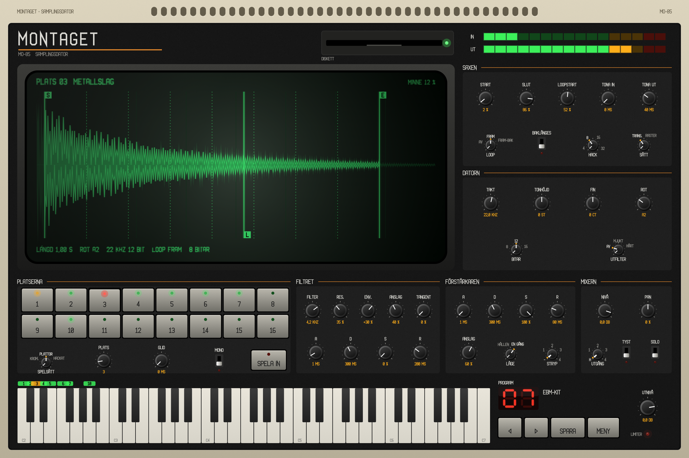
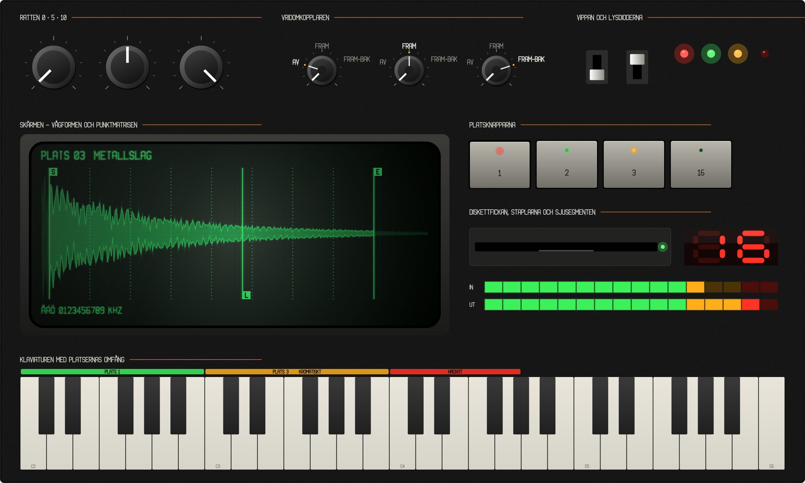

# Montaget

*Modell MO-85. Samplingsdatorn i elektronmusikstudion* – ett instrument som spelar dina egna ljud som ett 80-talssamplingsinstrument: klipper, vänder, loopar, hackar och smutsar ned dem.

Instrument (VST3, AU, CLAP) och fristående app för macOS. Syskon till [Röstverket](../rostverket) och [Kroppsmaskinen](../kropps-maskinen). Montaget har inga inspelade ljud med sig – fabriksljuden räknas fram i kod – och kan därför spridas.

**Status: fas 0.** Det tomma instrumentet är tyst, alla 584 parametrar finns, bussarna och appen finns, och stilprovet är ritat. Grind 0 väntar på att stilprovet godkänns och att instrumentet laddar i Reaper. Se [PLAN.md](PLAN.md).



## Instrumentet

```
FILER / INGÅNG ─▶ ARKIVET (16 platser) ─▶ SAXEN ─▶ DATORN ─▶ FILTRET ─▶ FÖRSTÄRKAREN ─▶ MIXERN ─▶ LIMITER ─▶ UT
MIDI ─▶ KLAVIATUREN: KROMATISKT · PLATTOR · HACKAT ─▶ 16 röster
```

| Del | Vad | Fas |
| --- | --- | --- |
| Arkivet | 16 platser: filer (WAV, AIFF, FLAC), inspelning från ingången eller fabriksljud | 1–2 |
| Saxen | Start, slut, loop (fram, fram-bak), baklänges, toning, hackning i 4–32 bitar | 1–2 |
| Datorn | Sampletakt 4–44,1 kHz utan filter före, 8/12/16 bitar, utfilter, tonhöjd, fin, rotton | 2 |
| Filtret | Lågpass 24 dB med resonans, envelopp, anslag och tangentföljning | 2 |
| Förstärkaren | ADSR, anslag, HÅLLEN eller EN GÅNG, strypgrupper | 1–2 |
| Mixern | Nivå, panorering, utgång (Huvud eller grupp 1–4), tyst och solo | 2 |

## Panelen

En samplingsdator kring 1983–85: ljusbeige plåtlåda med ventilationsgaller, svart front med silvertryck, en grön fosforskärm med vågformen och punktmatrisskrift, platsknappar med lysdioder, diskettficka, lysdiodsstaplar, sjusegment och klaviatur. Designstorlek 1200 × 800, skalas 60–160 % i hörnet.



## Bygga

Samma verktyg som syskonen (Xcode 15+, CMake 3.22+). `krang-libs` ska ligga bredvid den här mappen.

```sh
./local.sh     # Debug: appen, testfallen, stilprovet och panelbilden
./real.sh      # Release: VST3 + AU + CLAP, kopieras till ~/Library/Audio/Plug-Ins
```

## Testa

- `MORender --test` – fas 0: tyst på alla utgångar, inget NaN, bussarna, latensen, tillståndet, parametrarnas antal och ordning.
- `MORender --parametrar fil.txt`, `MORender --state fil.xml [id=värde ...]` – för Reaper-skripten.
- `MOSnapshot --stilprov docs/stilprov.png 2`, `--stilprov-detaljer`, `docs/panelen.png 2` och `--tid`.
- pluginval nivå 5 (VST3).

## Struktur

| Sökväg | Innehåll | Ansvarig |
| --- | --- | --- |
| `Source/Parameters.h` | Parameterträdet – ID:n får aldrig döpas om | Justine |
| `Source/PluginProcessor.*` | Processorn, bussarna och tillståndet | Justine / Sara |
| `Source/motor/` | Arkivet, rösterna, saxen och datorn (från fas 1) | Sara |
| `Source/ui/Panelen.h` | Panelen kopplad till parametrarna | Philip |
| `Source/ui/stil/` | Datorstudions palett, ritverktyg, panelbild och stilprov | Philip |
| `Source/app/App.cpp` | Den fristående appen | Justine |
| `tools/MORender.cpp` | Rendering och testfall | Doktor Krang / Sara |
| `tools/MOSnapshot.cpp` | Panelen och stilprovet till PNG | Philip |
| `.github/workflows/` | Bygge, test och pluginval | Justine |

## Faser

- **Fas 0** – grunden och stilprovet (pågår).
- **Fas 1** – rösterna och arkivet.
- **Fas 2** – klippet och smutsen.
- **Fas 3** – panelen.
- **Fas 4** – fabriksbandet (1.0).

## Licens

GNU Affero General Public License v3.0 – se [LICENSE](LICENSE). Montaget använder JUCE under dess AGPLv3-licens.
